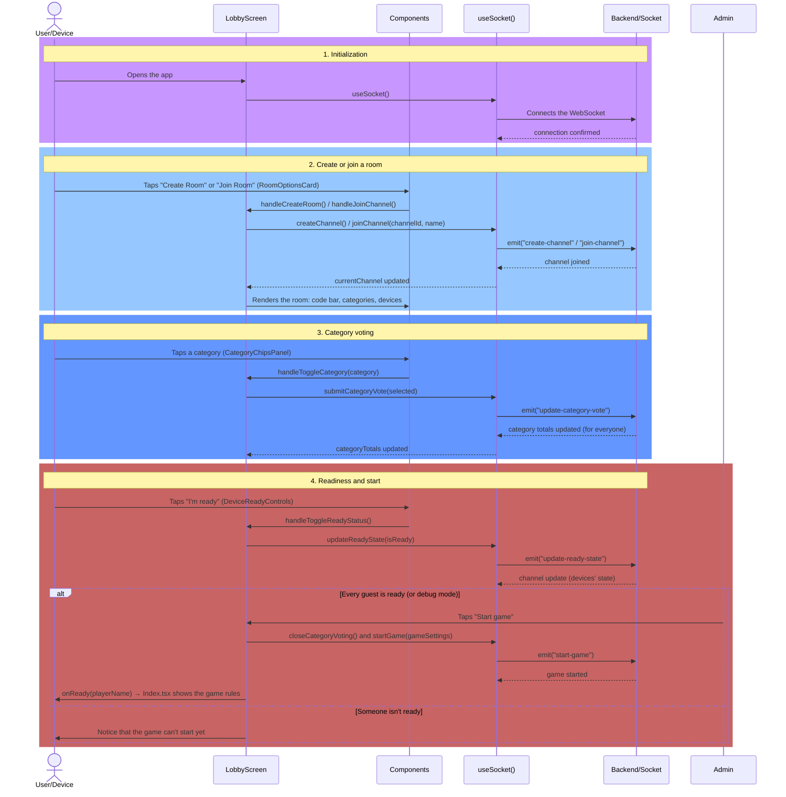
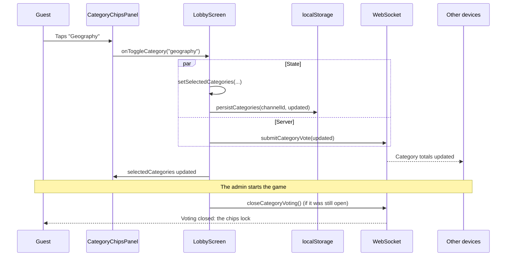

# Lobby Components

Architecture, components and data flow of the lobby: the screen where a room is created or joined,
its categories are voted, its players get ready and its game settings are set.

## Contents

1. [Overview](#overview)
2. [Component Architecture](#component-architecture)
3. [Data Flow](#data-flow)
4. [Sequence Diagrams](#sequence-diagrams)
5. [Components](#components)
6. [Hooks and Services](#hooks-and-services)
7. [Tests](#tests)
8. [Troubleshooting](#troubleshooting)

## Overview

The lobby is responsible for:

- Creating and joining rooms (by code, by QR code or by the `/join/:roomCode` link)
- Keeping every device of the room in sync (`useSocket`, over Socket.IO)
- Voting on the categories of the questions
- Roles: the admin (signed in, creates the room and runs the game) and the guests (who play)
- The players' readiness before the game starts
- The admin's game settings and power-up settings, saved per user
- The language, and the tutorial (`/tutorial` from the home, a full-screen dialog inside a room)

**Main file**: `LobbyScreen.tsx` (the orchestrator, which holds the screen's state)

## Component Architecture

```
LobbyScreen.tsx (orchestrator)
├── Header: connection badge, logo, language / room menu / leave / tutorial buttons
├── Before joining a room
│   ├── LanguageMenu, LoginDialog, tutorial link
│   └── RoomOptionsCard (deck of sample questions + create / join buttons, or the join form)
├── After joining a room
│   ├── Room code bar (copy button, QR code button)
│   ├── CategoryDrawer (admin) / CategoryChipsPanel (guest)
│   ├── ConnectedDevicesList
│   │   ├── DeviceAvatar
│   │   └── DeviceReadyControls
│   └── Ready status, start button (admin) / waiting notice (guest)
└── Dialogs
    ├── GameSettingsCard (admin, in a dialog)
    ├── PowerUpSettingsCard (admin, in a dialog)
    ├── EditNameDialog
    ├── RoomQRCodeDialog
    └── TutorialDialog (components/tutorial)

RoomMenu: the admin's tools (settings, power-ups, categories, tutorial, language, leave) in one menu
```

`ConnectionStatusCard`, `ActiveRoomCard`, `VotingControlCard` and `CategoryResultsDialog` are still
exported, but `LobbyScreen` no longer renders them (their jobs moved to the header, the room code
bar and the category drawer).

## Data Flow

```
LobbyScreen (state management)
    ↓
useSocket() hook (passed in as the `socket` prop)
    ├─→ WebSocket connection
    ├─→ Real-time events
    └─→ Shared state (devices, category totals, game settings, ...)
    ↓
Components (presentational)
    ├→ RoomOptionsCard
    ├→ CategoryDrawer / CategoryChipsPanel
    ├→ ConnectedDevicesList
    └→ GameSettingsCard / PowerUpSettingsCard
```

The admin's game settings flow the other way: the admin changes them in the dialogs, `LobbyScreen`
sends them to the server (`updateGameSettings`), and the server gives them to the guests. The
settings the admin saved (`src/services/userSettings.ts`) are loaded after a login.

## Sequence Diagrams

### Complete Flow



### Voting



## Components

### LobbyScreen.tsx (orchestrator)

**Props**:

```tsx
type LobbyScreenProps = {
  onReady: (playerName: string) => void; // The game is about to start
  socket: ReturnType<typeof useSocket>; // The realtime connection and the room's state
  initialRoomCode?: string; // From the /join/:roomCode link
};
```

**Responsibilities**:

- Orchestrating the components and holding the screen's state (room code input, selected categories,
  the admin's game settings, which dialogs are open)
- The business rules: creating and joining rooms, voting, readiness, starting the game
- Syncing with the socket, and persisting the categories in `localStorage`
- Playing the intro music for the admin, and leaving the room (`useLeaveRoom`)

---

### RoomOptionsCard.tsx

The home screen's card. Two states:

- **Initial**: a fan of sample question cards (`StaggerCards`, in `components/ui`) with the "Create
  Room" and "Join Room" buttons resting on the center card. The cards advance by themselves until the
  player touches them (arrows, tap, swipe or the ←/→ keys). The questions are in `lobby.deck` in the
  locales.
- **Join**: the form with the player's name and the room code.

On a phone on its side the card goes beside the home's logo: the deck stays in its column, and the
form has its two fields side by side.

**Features**:

- Input validation and sanitizing of the code (it drops the letters and digits that look alike:
  O, I, 0 and 1)
- Enter confirms the form
- Creating a room needs a valid login

---

### CategoryDrawer.tsx (admin)

The admin's voting panel: a drawer (a side panel on wide screens and on a phone on its side) that
follows the votes in real time. Only the guests vote.

- The status and a description for the admin
- The selection counter
- The ranking of the most voted categories (the top 10 are the game's categories)

### CategoryChipsPanel.tsx (guest)

The guests' inline voting, with chips.

- Selectable chips (`aria-pressed`)
- The selection counter, and a button to clear the selection
- Locks when voting is closed or the limit (the admin's `maxCategorySelections`) is reached

---

### ConnectedDevicesList.tsx

The room's players as rows sunk into a panel, like the rankings' rows. The player's own row is in
gold. The panel's header counts the players.

```tsx
type ConnectedDevicesListProps = {
  devices: Device[];
  currentDeviceId: string | null;
  isAdmin: boolean;
  onRemoveGuest: (deviceId: string) => void;
  onToggleReadyState: (deviceId: string, nextState: boolean) => void;
  onEditName?: (deviceId: string) => void;
  isGameStarted: boolean;
  canSelfToggleReady: boolean;
  selfRole: "admin" | "guest";
};
```

**Features**:

- `DeviceAvatar`: the admin's crown in gold, a guest's initial in navy. For the admin, a dot on the
  avatar says whether the device is on screen (green) or in the background (amber)
- A device without a name is named after its role (the admin) or the start of its id (a guest): the
  realtime server fills a missing name with the device's id
- The player's own name is a button with a pencil (it opens `EditNameDialog`)
- The role badge ("Guest") is only shown to the admin
- Guests don't see the admin in the list
- `DeviceReadyControls`: the player's own "I'm ready" button (only they can press it, and not once the
  game started), the others' "Ready / Waiting" pill, and the admin's round button that removes a
  guest

---

### GameSettingsCard.tsx and PowerUpSettingsCard.tsx (admin)

The contents of the two settings dialogs: the game's settings (questions, time, categories, streak,
cache, debug mode, ...) and the power-ups' (see [`docs/POWER_UPS.md`](../../../docs/POWER_UPS.md)).
Limits and defaults live in `src/types/gameSettings.ts` and `src/types/powerUpSettings.ts`, and the
realtime server checks them again.

### RoomMenu.tsx and LanguageMenu.tsx

`RoomMenu` gathers the admin's room tools behind one button in the header. `LanguageMenu` is the
language's menu (a flag button for guests and inside a room, a globe on the home screen). Both menus
are not modal: a modal menu would lock the body's scroll and unstick the sticky header.

### RoomCodePill.tsx

The room's code, with buttons to copy it and to show its QR code: under the lobby's header on a
phone held upright, in the header's middle (in the logo's place) on a phone on its side.

### EditNameDialog.tsx, RoomQRCodeDialog.tsx

Dialogs to change the player's name (it rejoins the room with the new name) and to show the room's
QR code, which links to `/join/<room code>`.

### Not rendered at the moment

- `ConnectionStatusCard`: the connection status, the device id and a button to reset the session
- `ActiveRoomCard`: the room code, with a copy button, the device count and a leave button
- `VotingControlCard`: the admin's button to close the voting
- `CategoryResultsDialog`: the top 10 categories after the voting closes

## Hooks and Services

### useSocket()

Manages the whole WebSocket communication (`src/hooks/useSocket.ts`).

```tsx
const {
  // Connection
  isConnected,
  currentChannel,
  deviceId,

  // Users and devices
  channelDevices,
  selfRole, // "admin" | "guest"

  // Categories
  categoryTotals,
  maxCategorySelections,
  isVotingClosed,
  isGameStarted,

  // Game settings
  gameSettings,
  updateGameSettings,

  // Methods
  connect,
  createChannel,
  joinChannel,
  leaveChannel,
  submitCategoryVote,
  closeCategoryVoting,
  removeGuest,
  updateReadyState,
  startGame,
  // ... more
} = useSocket(locale, { accessToken, onSessionExpired });
```

### Other hooks and services

| Name                      | What it does                                                                          |
| ------------------------- | ------------------------------------------------------------------------------------- |
| `useIsDesktop()`          | Media query hook (`useMediaQuery.ts`) that tells wide screens from phones             |
| `useIsPhoneLandscape()`   | Whether the phone is on its side (`useMediaQuery.ts`), like `phone-landscape:`        |
| `useCategoryStorage()`    | Keeps the player's categories in `localStorage`, per room                             |
| `useLeaveRoom()`          | Leaves the room from the lobby: the room forgets the device, and a new session starts |
| `useAuth()`               | The admin's Supabase session                                                          |
| `fetchUserSettings(user)` | The game settings the admin saved (`src/services/userSettings.ts`)                    |

Shared constants (the categories and their limits) are in `src/constants/categories.ts`.

## Tests

Tests are next to the components, in `__tests__/`: one file for each component, and
`LobbyScreen.test.tsx` / `LobbyScreen.readiness.test.tsx` for the screen (they share fakes through
`LobbyScreenTestUtils.ts`). Run them with `npm run test:run` (see [`docs/TESTING.md`](../../../docs/TESTING.md)).

## Troubleshooting

| Problem                       | What to check                                                                         |
| ----------------------------- | ------------------------------------------------------------------------------------- |
| Chips don't show up           | `currentChannel`, and that the device is a guest (the admin has the drawer)           |
| Votes don't sync              | The WebSocket connection (`isConnected`) and `VITE_SOCKET_URL`                        |
| Selection locked unexpectedly | The selection limit and `isVotingClosed`                                              |
| "Create Room" is disabled     | The admin must be signed in, and the socket connected                                 |
| The game can't start          | Every guest must be ready (and there must be a guest, unless debug mode is on)        |
| Other devices can't connect   | See [`docs/LOCAL_NETWORK.md`](../../../docs/LOCAL_NETWORK.md) (`VITE_SOCKET_URL`, IP) |

## References

- [Socket.IO](https://socket.io/)
- [shadcn/ui](https://ui.shadcn.com/)
- [React hooks](https://react.dev/reference/react)
