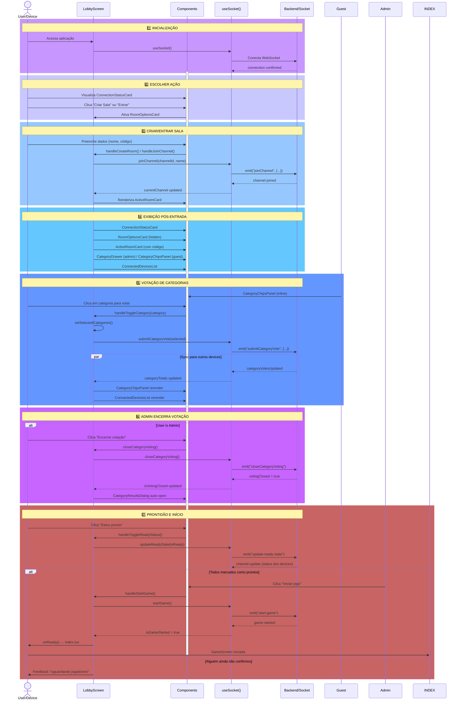
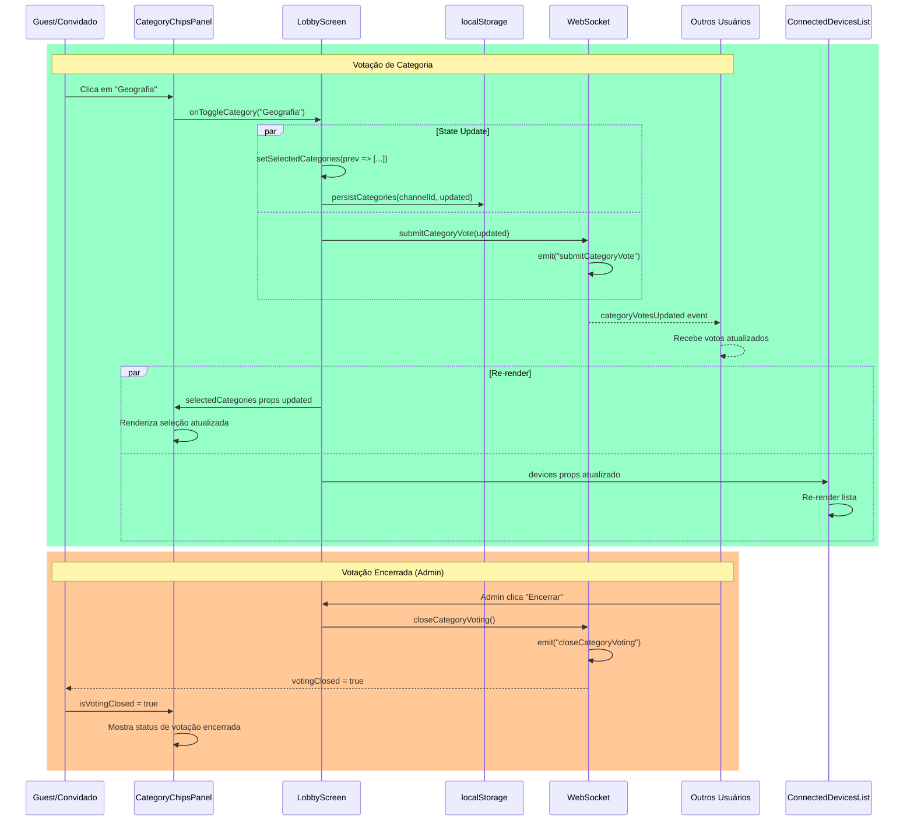

# 🎯 Componentes Lobby - Documentação Detalhada

Documentação completa da arquitetura, componentes e fluxo de dados da tela de Lobby do Millionaire Brain Quiz.

## 📋 Índice

1. [Visão Geral](#visão-geral)
2. [Arquitetura de Componentes](#arquitetura-de-componentes)
3. [Fluxo de Dados](#fluxo-de-dados)
4. [Diagrama de Sequência](#diagrama-de-sequência)
5. [Componentes Detalhados](#componentes-detalhados)
6. [Hooks Customizados](#hooks-customizados)
7. [Refatoração](#refatoração)

## 🎯 Visão Geral

O módulo Lobby é responsável pela:

- ✅ Criação e entrada em salas de jogo
- ✅ Sincronização de múltiplos dispositivos
- ✅ Votação de categorias de perguntas
- ✅ Gerenciamento de roles (admin/guest)
- ✅ Exibição em tempo real de votos
- ✅ Confirmação de prontidão antes de iniciar o jogo

**Arquivo Principal**: `LobbyScreen.tsx` (~420 linhas)

**Estado Total de Componentes**: 9 componentes especializados

## 🏗️ Arquitetura de Componentes

```
LobbyScreen.tsx (Orchestrator)
├── Pré-entrada na sala
│   ├── ConnectionStatusCard
│   └── RoomOptionsCard
└── Pós-entrada na sala
    ├── ActiveRoomCard
    ├── CategoryDrawer (admin)
    ├── CategoryChipsPanel (guest)
    ├── CategoryResultsDialog
    └── ConnectedDevicesList
```

## 🔄 Fluxo de Dados

```
LobbyScreen (State Management)
    ↓
useSocket() Hook
    ├─→ WebSocket Connection
    ├─→ Real-time Events
    └─→ Shared State
    ↓
Components (Presentational)
    ├→ ConnectionStatusCard
    ├→ RoomOptionsCard
    ├→ ActiveRoomCard
    ├→ CategoryDrawer / CategoryChipsPanel
    └→ ConnectedDevicesList
```

## 📊 Diagrama de Sequência - Fluxo Completo



## 🎨 Fluxo de Votação (Detalhe)



## 📱 Componentes Detalhados

### 1. **LobbyScreen.tsx** (Orchestrator)

**Responsabilidade**: Gerenciamento global do estado e fluxo

**Props**:

```tsx
interface LobbyScreenProps {
  onReady: () => void; // Callback para iniciar jogo
}
```

**Estados Principais**:

- `channelInput` - Código da sala digitado
- `hasJoinedChannel` - Se entrou em sala
- `selectedCategories` - Categorias votadas

**Responsabilidades**:

- ✅ Orquestração de componentes
- ✅ Gerenciamento de estado global
- ✅ Lógica de negócio (votação, entrada sala)
- ✅ Sincronização com socket
- ✅ Persistência em localStorage

---

### 2. **ConnectionStatusCard.tsx**

**Responsabilidade**: Exibir status de conexão WebSocket

**Props**:

```tsx
interface ConnectionStatusCardProps {
  isConnected: boolean;
  isPageVisible: boolean;
  isReturningUser: boolean;
  currentChannel: string | null;
  deviceId: string | null;
  isAdmin: boolean;
  onResetSession: () => void;
}
```

**Exibições**:

- ✅ Conectado / Desconectado
- ✅ Ativo / Em segundo plano
- ✅ Device ID
- ✅ Role (ADMIN / GUEST)
- ✅ Botão para resetar sessão

---

### 3. **RoomOptionsCard.tsx**

**Responsabilidade**: Entrada/Criação de sala

**Props**:

```tsx
interface RoomOptionsCardProps {
  isConnected: boolean;
  showJoinInput: boolean;
  channelInput: string;
  guestName: string;
  onCreateRoom: () => void;
  onShowJoinInput: () => void;
  // ... mais callbacks
}
```

**Estados**:

- **Inicial**: Botões "Criar Sala" e "Entrar em Sala"
- **Entrada**: Form com nome e código

**Features**:

- ✅ Validação de entrada
- ✅ Sanitização do código (remove O, I, 1, 0)
- ✅ Auto-geração de código (criar sala)
- ✅ Enter para confirmar

---

### 4. **ActiveRoomCard.tsx**

**Responsabilidade**: Exibir info da sala ativa

**Props**:

```tsx
interface ActiveRoomCardProps {
  currentChannel: string | null;
  channelInput: string;
  totalDevices: number;
  isAdmin: boolean;
  onLeaveChannel: () => void;
}
```

**Features**:

- ✅ Código da sala em destaque
- ✅ Botão copiar código
- ✅ Contador de dispositivos
- ✅ Info de role (admin/guest)
- ✅ Botão sair da sala

---

### 5. **CategoryDrawer.tsx**

**Responsabilidade**: Painel de votação do admin (drawer com status e controle)

**Props**:

```tsx
interface CategoryDrawerProps {
  open: boolean;
  onOpenChange: (open: boolean) => void;
  isDesktopView: boolean;
  drawerSnapPoint: number | string;
  setDrawerSnapPoint: (snapPoint: number | string) => void;
  isAdmin: boolean;
  isVotingClosed: boolean;
  selectedCategories: string[];
  categorySelectionLimit: number;
  categoryTotals: { name: string; votes: number }[];
  isSelectionDisabled: boolean;
  onToggleCategory: (category: string) => void;
  onClearSelections: () => void;
}
```

**Features**:

- ✅ Status e descricoes para admin
- ✅ Contador de selecao no header
- ✅ Acesso ao ranking em tempo real
- ✅ Lista categorias selecionadas pelos convidados
- ✅ Controle de painel (open/close)

---

### 6. **CategoryChipsPanel.tsx**

**Responsabilidade**: Votacao inline com chips (guest)

**Props**:

```tsx
interface CategoryChipsPanelProps {
  isAdmin: boolean;
  isVotingClosed: boolean;
  selectedCategories: string[];
  categorySelectionLimit: number;
  isSelectionDisabled: boolean;
  onToggleCategory: (category: string) => void;
  onClearSelections: () => void;
}
```

**Features**:

- ✅ Chips clicaveis para selecao
- ✅ Contador de seleção no header
- ✅ Botão para limpar seleção

---

### 7. **ConnectedDevicesList.tsx**

**Responsabilidade**: Lista de dispositivos conectados

**Props**:

```tsx
interface ConnectedDevicesListProps {
  devices: Device[];
  currentDeviceId: string | null;
  isAdmin: boolean;
  onRemoveGuest: (deviceId: string) => void;
  onToggleReadyState: (deviceId: string, nextState: boolean) => void;
  isGameStarted: boolean;
}
```

**Features**:

- ✅ Avatar com status (ativo/background)
- ✅ Nome e ID do dispositivo
- ✅ Role badge
- ✅ "Você" indicator
- ✅ Botão de prontidão por jogador (somente o próprio pode clicar)
- ✅ Badge "Pronto/Aguardando" sincronizado em tempo real
- ✅ Botão remover guest (admin only)

---

### 8. **CategoryResultsDialog.tsx**

**Responsabilidade**: Modal de resultados finais

**Props**:

```tsx
interface CategoryResultsDialogProps {
  open: boolean;
  onOpenChange: (open: boolean) => void;
  categoryTotals: CategoryTotal[];
}
```

**Features**:

- ✅ Ranking das 10 categorias
- ✅ Contagem de votos
- ✅ Auto-open quando votação encerra

## 🎣 Hooks Customizados

### **useSocket()** 📡

Gerencia toda comunicação WebSocket

```tsx
const {
  // Connection
  isConnected: boolean;
  currentChannel: string | null;
  deviceId: string | null;

  // Users & Devices
  channelDevices: Device[];
  totalDevices: number;
  selfRole: 'admin' | 'guest';

  // Categories
  categoryTotals: CategoryTotal[];
  maxCategorySelections: number;
  isVotingClosed: boolean;
  isGameStarted: boolean;

  // Methods
  connect: () => void;
  joinChannel: (channelId: string, displayName?: string) => void;
  leaveChannel: () => void;
  submitCategoryVote: (categories: string[]) => void;
  closeCategoryVoting: () => void;
  removeGuest: (deviceId: string) => void;
  updateReadyState: (isReady: boolean) => void;
  startGame: () => void;
  // ... mais métodos
} = useSocket();
```

### **useMediaQuery()** 📱

Hook para media queries responsivas

```tsx
const isDesktop = useMediaQuery("(min-width: 768px)");

// Atalho customizado
const isDesktopView = useIsDesktop();
```

### **useCategoryStorage()** 💾

Gerencia persistência de categorias em localStorage

```tsx
const {
  loadStoredCategories: (channelId: string) => string[];
  persistCategories: (channelId: string, categories: string[]) => void;
  clearPersistedCategories: (channelId?: string) => void;
} = useCategoryStorage();
```

## 🔄 Refatoração

### Antes ❌

- **Arquivo único**: ~1080 linhas
- **Responsabilidades mistas**: UI + lógica + estado
- **Dificuldade de teste**: Componente monolítico
- **Reutilização baixa**: Componentes acoplados

### Depois ✅

- **9 Componentes**: Cada um ~50-150 linhas
- **Responsabilidade única**: Cada componente faz uma coisa bem
- **Testável**: Componentes isolados com props claras
- **Reutilizável**: Componentes independentes e compostos

### Componentes Extraídos

```
ConnectionStatusCard.tsx    (80 linhas)
RoomOptionsCard.tsx        (110 linhas)
ActiveRoomCard.tsx         (95 linhas)
ConnectedDevicesList.tsx   (75 linhas)
CategoryDrawer.tsx         (180 linhas)
CategoryChipsPanel.tsx     (160 linhas)
CategoryResultsDialog.tsx  (45 linhas)
LobbyScreen.tsx           (420 linhas) ← Orquestrador
─────────────────────────────────────
TOTAL                     (~1005 linhas)
```

### Hooks Extraídos

```
useMediaQuery.ts          (30 linhas)
useCategoryStorage.ts     (60 linhas)
```

### Constantes Centralizadas

```
constants/categories.ts   (Categorias e constantes)
```

## 📊 Padrões e Boas Práticas

### Component Pattern

```tsx
// Props interface claramente definida
interface ComponentProps {
  required: string;
  optional?: number;
  callback: (value: string) => void;
}

// Componente funcional com TypeScript
export function Component({ required, optional, callback }: ComponentProps) {
  return <div>...</div>;
}
```

### Custom Hooks Pattern

```tsx
// Hook com lógica isolada
export function useCustomLogic() {
  const [state, setState] = useState();

  return {
    state,
    method: () => {
      /* lógica */
    },
  };
}
```

### State Management

```tsx
// LobbyScreen é o "single source of truth"
// Componentes filhos recebem props e callbacks
// Comunicação bidirecional via props + eventos
```

## 🚀 Performance

### Otimizações Implementadas

- ✅ `useCallback` para callbacks estáveis
- ✅ `useEffect` com dependências específicas
- ✅ Componentes pequenos = re-renders rápidos
- ✅ Drawer com scroll independente (não afeta pai)

### Re-render Flow

```
LobbyScreen (1x por mudança de estado)
    ↓ Props changes
Componentes filhos re-render (apenas os afetados)
    ↓ Callback events
LobbyScreen state updates
    ↓ Nova renderização
```

## 📝 Exemplo de Uso

```tsx
// App.tsx / Index.tsx
import { LobbyScreen } from "@/components/lobby";

export default function App() {
  const handleLobbyReady = () => {
    // Transição para tela do quiz
  };

  return <LobbyScreen onReady={handleLobbyReady} />;
}
```

## 🐛 Debug & Troubleshooting

### Logs Úteis

```tsx
// Habilitar logs de socket
useEffect(() => {
  console.log("currentChannel:", currentChannel);
  console.log("categoryTotals:", categoryTotals);
}, [currentChannel, categoryTotals]);
```

### Common Issues

| Problema                        | Solução                             |
| ------------------------------- | ----------------------------------- |
| Chips não aparecem              | Verificar `currentChannel` e role   |
| Votos não sincronizam           | Verificar WebSocket conexão         |
| Seleção bloqueada indevidamente | Verificar limite e `isVotingClosed` |

## 📚 Referências

- [Socket.IO - Real-time](https://socket.io/)
- [Shadcn/UI - Components](https://ui.shadcn.com/)
- [React Hooks - Documentation](https://react.dev/reference/react)

## 🎓 Conclusão

A refatoração do Lobby transformou um componente monolítico em uma arquitetura modular e escalável, mantendo toda a funcionalidade enquanto melhorando:

- ✅ Legibilidade
- ✅ Manutenibilidade
- ✅ Testabilidade
- ✅ Reutilização
- ✅ Performance

---

**Versão**: 1.0
**Última atualização**: Dezembro 2024
**Mantido por**: Victor Amorim
